# Rocky Linux 10.2 서버 취약점 점검 및 조치 (KISA 주통기 U-01 ~ U-67)

KISA 주요정보통신기반시설 기술적 취약점 분석, 평가 가이드의 Unix/Linux 서버 항목을 Bash 스크립트로 점검하고, 취약 항목을 조치한 결과를 정리한 문서입니다. 점검 스크립트는 설정을 바꾸지 않고 결과만 출력합니다.

## 1. 점검 개요

| 항목 | 내용 |
|---|---|
| 점검 대상 | 리눅스 서버 MASTER, SLAVE (Rocky Linux 10.2) |
| 역할과 서비스 | MASTER: 웹, DNS, 메일, 파일 (httpd, named, postfix, dovecot, nfs, smb). SLAVE: 이중화 백업(VRRP standby), MASTER와 동일 구성 |
| 이중화 구성 | keepalived(VRRP) + haproxy |
| 점검 기준 | 주요정보통신기반시설 기술적 취약점 분석, 평가 상세가이드(2026, KISA), 66개 항목 |
| 점검 방식 | Bash 점검 스크립트로 점검한 뒤 결과를 수동 검증(오탐 제외)해 판정. 취약 항목은 조치 전 설정을 백업하고 조치한 뒤 같은 스크립트로 재점검하고 서비스 정상 동작을 확인 |
| 점검 제한 사항 | Ubuntu DB(MariaDB), 웹 애플리케이션 계층은 제외 (차기 점검 권고) |

## 2. 점검 결과 요약 (MASTER 기준)

| 분야 | 점검 | 양호 | 취약 | 해당없음 |
|---|---|---|---|---|
| 계정 관리 | 13 | 7 | 6 | 0 |
| 파일, 디렉터리 | 20 | 16 | 3 | 1 |
| 서비스 관리 | 30 | 19 | 6 | 5 |
| 로그 관리 | 3 | 3 | 0 | 0 |
| **합계** | **66** | **45** | **15** | **6** |

위 표는 **조치 전** 기준입니다. 취약 15건 중 14건을 조치 완료하고 1건(U-28)은 권고로 처리해, 조치 후에는 **양호 59건, 취약(권고) 1건, 해당없음 6건**이 되었습니다. SLAVE도 MASTER와 같은 결과였습니다.

## 3. 점검 스크립트와 조치 전후 결과

판정은 양호(초록)와 취약(빨강), 수동확인과 해당없음(노랑)으로 색을 구분해 한 줄씩 출력됩니다.

### 계정 관리 (U-01 ~ U-06)

점검 스크립트: `Account_check.sh`

조치 전 취약 4건 -> 조치 후 전체 양호

| 조치 전 | 조치 후 |
|---|---|
| 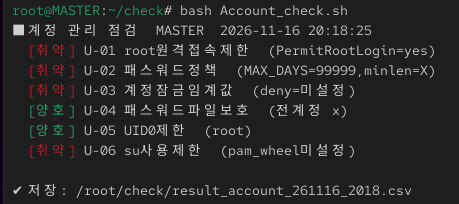 | 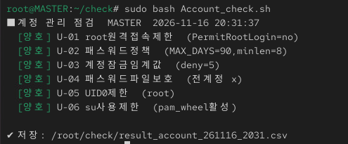 |

| 코드 | 점검 항목 | 위험도 | 조치 전 현황 | 조치 내용 | 결과 |
|---|---|---|---|---|---|
| U-01 | root 계정 원격 접속 제한 | 상 | /etc/ssh/sshd_config -> PermitRootLogin yes (root 원격 직접 접속 허용) | PermitRootLogin no 로 변경 후 sshd 재시작 (일반계정+sudo 접속 확인) | 조치완료 |
| U-02 | 패스워드 관리정책 설정 | 상 | PASS_MAX_DAYS=99999(무제한), pwquality minlen 미설정 (복잡성 정책 없음) | login.defs PASS_MAX_DAYS 90, pwquality.conf minlen=8 minclass=3 설정 | 조치완료 |
| U-03 | 계정 잠금 임계값 설정 | 상 | faillock deny 미설정 (로그인 실패 제한 없음 -> 무차별 대입 공격 노출) | faillock.conf deny=5 unlock_time=900, authselect with-faillock 적용 | 조치완료 |
| U-06 | 사용자 계정 su 기능 제한 | 상 | /etc/pam.d/su 내 pam_wheel 미설정 (모든 사용자가 su 시도 가능) | pam_wheel.so use_uid 활성화, 관리자 계정을 wheel 그룹에 추가 | 조치완료 |

### 파일, 디렉터리 관리 (U-14 ~ U-33)

점검 스크립트: `File_check.sh`

조치 전 취약 2건 -> 조치 후 전체 양호

| 조치 전 | 조치 후 |
|---|---|
| 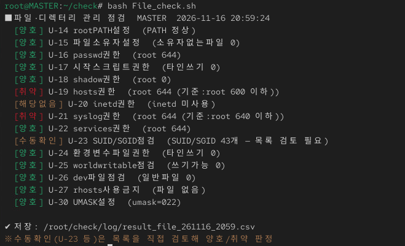 | 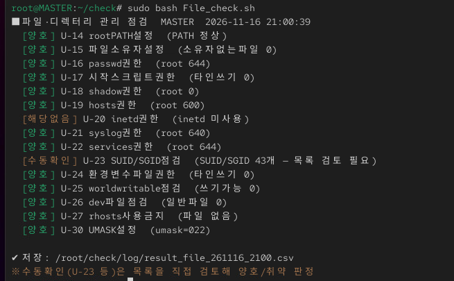 |

| 코드 | 점검 항목 | 위험도 | 조치 전 현황 | 조치 내용 | 결과 |
|---|---|---|---|---|---|
| U-19 | /etc/hosts 파일 소유자 및 권한 설정 | 상 | /etc/hosts 소유자 root, 권한 644 (기준 600 초과) | chmod 600 /etc/hosts | 조치완료 |
| U-21 | /etc/(r)syslog.conf 파일 소유자 및 권한 설정 | 상 | /etc/rsyslog.conf 소유자 root, 권한 644 (기준 640 초과) | chmod 640 /etc/rsyslog.conf | 조치완료 |

### 서비스 관리 (U-34 ~ U-63)

점검 스크립트: (서비스 점검 스크립트는 아직 저장소에 없음)

조치 전 취약 6건 -> 조치 후 전체 양호

| 조치 전 | 조치 후 |
|---|---|
| 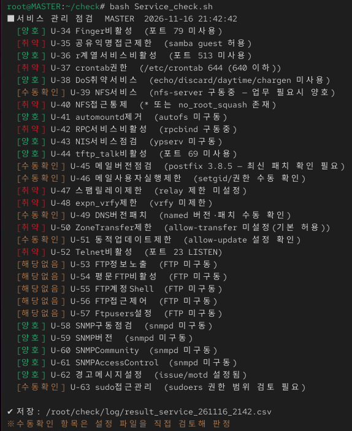 | 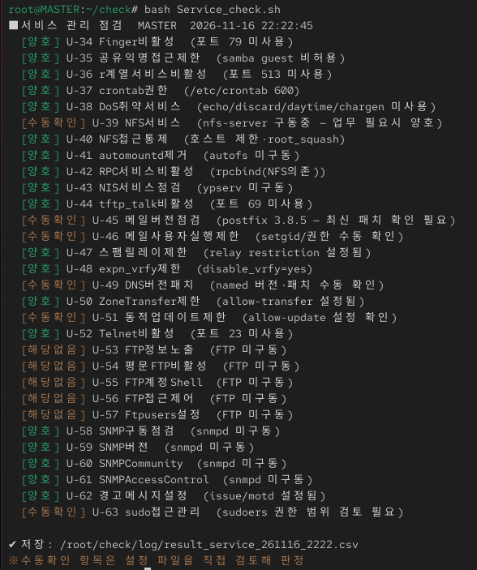 |

| 코드 | 점검 항목 | 위험도 | 조치 전 현황 | 조치 내용 | 결과 |
|---|---|---|---|---|---|
| U-35 | 공유 서비스에 대한 익명 접근 제한 설정 | 상 | smb.conf guest ok = yes (익명 접근 허용) | guest ok = no 로 변경 후 smb 재시작 | 조치완료 |
| U-37 | crontab 설정파일 권한 설정 미흡 | 상 | /etc/crontab 권한 644 (기준 640 초과) | chmod 600 /etc/crontab | 조치완료 |
| U-40 | NFS 접근 통제 | 상 | /etc/exports no_root_squash (원격 root 권한 허용) | no_root_squash -> root_squash 변경 후 exportfs -ra | 조치완료 |
| U-48 | expn, vrfy 명령어 제한 | 중 | postfix disable_vrfy_command = no (VRFY 노출) | disable_vrfy_command = yes 설정 후 postfix 재시작 | 조치완료 |
| U-50 | DNS Zone Transfer 설정 | 상 | named.conf allow-transfer 미설정 (존 전송 기본 허용) | allow-transfer { none; } 설정 (보조 DNS 운영 시 해당 IP로 한정) | 조치완료 |
| U-52 | Telnet 서비스 비활성화 | 중 | telnet.socket 활성, 포트 23 LISTEN | systemctl disable --now telnet.socket | 조치완료 |

### 보완 점검 (U-07 ~ U-13, U-28 ~ U-33, U-65 ~ U-67)

점검 스크립트: `Rest_check.sh`

조치 전 취약 3건(U-12, U-13, U-28) -> 조치 후 U-28만 권고로 남음

| 조치 전 | 조치 후 |
|---|---|
| 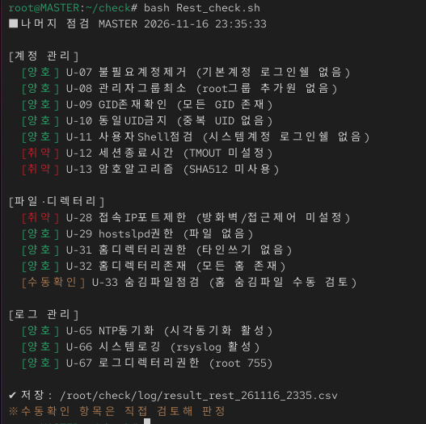 | 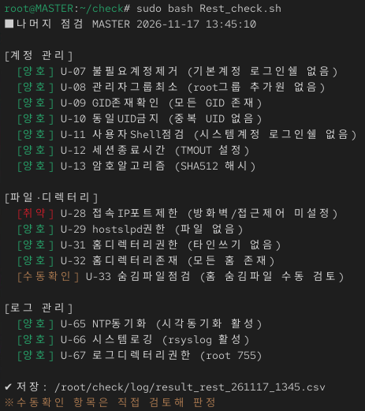 |

| 코드 | 점검 항목 | 위험도 | 조치 전 현황 | 조치 내용 | 결과 |
|---|---|---|---|---|---|
| U-12 | 세션 종료 시간 설정 | 하 | /etc/profile TMOUT 미설정 | /etc/profile에 export TMOUT=600 추가(10분) | 조치완료 |
| U-13 | 안전한 패스워드 암호화 알고리즘 사용 | 중 | 10조마켓(1차 프로젝트 웹 서비스) 테스트 계정 user20~user55가 MD5($1$) 해시로 생성됨 (시스템 PAM 기본 알고리즘은 yescrypt) | 대상 테스트 계정 패스워드 재설정으로 yescrypt 재해시 + chage -d 0(다음 로그인 시 변경 강제) | 조치완료 |
| U-28 | 접속 IP 및 포트 제한 | 상 | firewalld 비활성, iptables INPUT 정책 ACCEPT (호스트 접근 통제 없음) | (계획된 변경 권고) Docker iptables 충돌, NFS 동적 포트, keepalived VRRP 의존성 식별 -> NFS 포트 고정 후 firewalld 규칙(SSH, 웹, DNS, 메일, Samba, DB, VRRP 허용) 적용 및 페일오버 테스트 권고. 현재 접근제어는 네트워크 계층(범위 외)에서 수행. | 권고 |

## 4. SLAVE 노드 점검

MASTER와 keepalived(VRRP) + haproxy로 이중화를 구성하는 SLAVE 노드도 같은 기준(66개 항목)으로 점검했습니다. SLAVE는 MASTER와 동일한 15개 취약 항목이 확인되었고(동일 이미지 기반 구성), MASTER와 같이 14건 조치 완료, U-28(호스트 방화벽) 1건을 권고로 처리했습니다.

**특이사항**: SLAVE는 sshd 드롭인 설정(`/etc/ssh/sshd_config.d/`)에 root 원격 접속 허용 값이 있어서, 메인 설정뿐 아니라 드롭인까지 추적해 실효 설정(`sshd -T`) 기준으로 조치했습니다.

| 구분 | 조치 전 | 조치 후 |
|---|---|---|
| 계정 관리 | 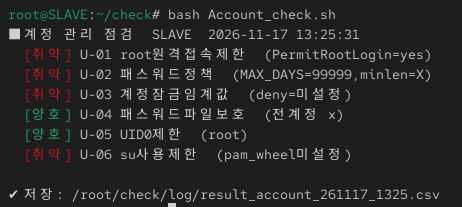 | 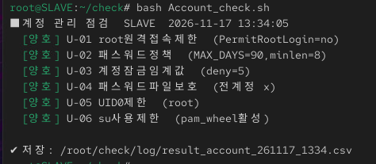 |
| 서비스 관리 | 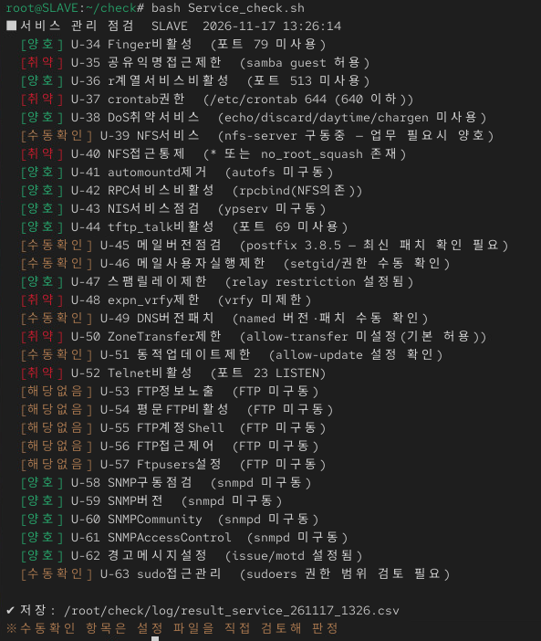 | 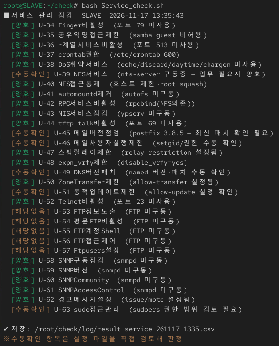 |
| 보완 점검 | 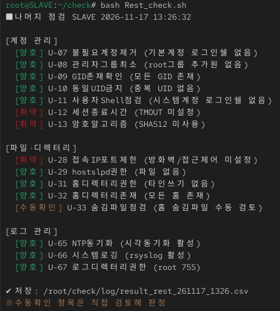 | 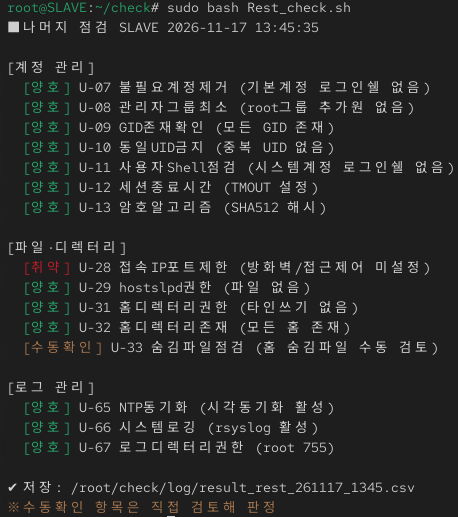 |

## 5. 권고 처리 항목 (1건)

| 코드 | 점검 항목 | 위험도 | 미조치 사유, 현재 상태 | 권고 조치 | 권고 기한 |
|---|---|---|---|---|---|
| U-28 (MASTER, SLAVE) | 호스트 방화벽 | 상 | Docker, NFS 동적 포트, VRRP 의존성으로 즉시 적용 시 서비스 영향 우려, 네트워크 구간에서 접근 통제(범위 외) | NFS 포트 고정 후 firewalld 허용 규칙 적용, 노드별 순차 적용과 페일오버 테스트 | 1개월 |

## 6. 오탐 검증 (5건)

자동 점검에서 취약으로 표시된 5건은 수동으로 확인해 판정에서 제외했습니다.

- **파일, 디렉터리 3건**: 컨테이너 레이어, 심볼릭 링크, 공유메모리 경로는 수동 검증 결과 실제 취약이 아니었습니다.
- **서비스 2건**: rpcbind는 NFS 운영에 필요한 의존 서비스이고, 메일 relay는 내부망으로 제한된 상태였습니다. 판별 로직을 보완해서 재점검했습니다.

## 7. 종합 의견

- **공통 취약 패턴**: 설치 시 기본 설정 방치. root 원격 접속 허용, 패스워드 정책과 계정 잠금 미설정, 일부 설정 파일 권한 과다 등 OS 기본값이 보안 기준보다 느슨했습니다.
- **우선 조치**: 위험도 '상' 항목(root 원격 접속, 패스워드 관리정책, 계정 잠금, su 기능 제한, /etc/hosts, rsyslog.conf 권한)을 우선 조치했고, U-28(권고)을 제외한 14건이 재점검 결과 양호로 전환되었습니다.
- **이중화(HA) 환경 고려**: MASTER는 keepalived(VRRP)+haproxy로 이중화되어 있어 서비스 영향이 없는 권한, 설정 변경 위주로 조치했습니다. 서비스 중단형 조치는 노드별 순차 적용과 페일오버 확인이 필요합니다. 양 노드를 같은 기준으로 점검하고 조치했으며, SLAVE는 sshd 드롭인 설정까지 추적해 조치했습니다.
- **재현성**: 점검을 셸 스크립트로 자동화해 일관성을 확보하고, 조치 후 재점검으로 개선 효과를 검증했습니다. 조치 전에는 대상 설정 파일을 백업했고, 조치 후에는 관련 서비스(httpd, named, postfix, nfs, smb)의 정상 동작을 확인했습니다.

## 8. 스크립트 사용법

```
(저장소 루트)
  점검 스크립트/   Account_check.sh, File_check.sh, Rest_check.sh
  images/          조치 전, 조치 후 점검 화면
```

```bash
sudo bash Account_check.sh
```

| 파일 | 점검 항목 | 결과 저장 위치 |
|---|---|---|
| Account_check.sh | 계정 관리 U-01 ~ U-06 | 현재 폴더의 `result_account_<날짜>.csv` |
| File_check.sh | 파일, 디렉터리 관리 U-14 ~ U-33 | 현재 폴더의 `result_file_<날짜>.csv` |
| Rest_check.sh | 계정 U-07 ~ U-13, 파일 U-28, 29, 31 ~ 33, 로그 U-65 ~ U-67 | `/root/check/log/result_rest_<날짜>.csv` |

서비스 관리(U-34 ~ U-63) 점검 스크립트는 아직 이 저장소에 추가되지 않았습니다.

모든 스크립트는 읽기 전용이고 `sudo` 실행을 권장합니다. 일부 항목(U-23, U-33 등)은 목록을 직접 검토해 판정하는 수동확인입니다. 조치는 위 표의 "조치 내용"에 적힌 명령(chmod, 설정 변경 후 서비스 재시작 등)으로 진행했습니다.

<details>
<summary>부록: 전체 66개 항목 점검 결과 (MASTER 기준)</summary>

| 코드 | 점검 항목 | 위험도 | 점검 결과 | 조치 | 비고 |
|---|---|---|---|---|---|
| U-01 | root 계정 원격 접속 제한 | 상 | 취약 | 조치완료 | PermitRootLogin yes->no 조치완료 (재점검 양호) |
| U-02 | 패스워드 관리정책 설정 | 상 | 취약 | 조치완료 | PASS_MAX_DAYS 99999->90, minlen=8 (재점검 양호) |
| U-03 | 계정 잠금 임계값 설정 | 상 | 취약 | 조치완료 | faillock deny=5 설정 (재점검 양호) |
| U-04 | 패스워드 파일 보호 | 상 | 양호 | - | 모든 계정 shadow(x) 사용 |
| U-05 | root 이외의 UID가 '0' 금지 | 상 | 양호 | - | UID 0 계정 root만 존재 |
| U-06 | 사용자 계정 su 기능 제한 | 상 | 취약 | 조치완료 | pam_wheel 활성화 (재점검 양호) |
| U-07 | 불필요한 계정 제거 | 하 | 양호 | - | 불필요 기본계정 로그인쉘 없음 |
| U-08 | 관리자 그룹에 최소한의 계정 포함 | 중 | 양호 | - | root그룹 추가원 없음 |
| U-09 | 계정이 존재하지 않는 GID 금지 | 하 | 양호 | - | 모든 GID 그룹 존재 |
| U-10 | 동일한 UID 금지 | 중 | 양호 | - | 중복 UID 없음 |
| U-11 | 사용자 Shell 점검 | 하 | 양호 | - | 시스템계정 로그인쉘 없음 |
| U-12 | 세션 종료 시간 설정 | 하 | 취약 | 조치완료 | TMOUT=600 설정 (재점검 양호) |
| U-13 | 안전한 패스워드 암호화 알고리즘 사용 | 중 | 취약 | 조치완료 | user20~55 등 MD5($1$)->yescrypt($y$) 재해시 (재점검 양호) |
| U-14 | root 홈, 패스 디렉터리 권한 및 패스 설정 | 상 | 양호 | - | root PATH 정상 |
| U-15 | 파일 및 디렉터리 소유자 설정 | 상 | 양호 | - | 소유자없는 파일 전부 컨테이너 레이어 -> 호스트 양호 |
| U-16 | /etc/passwd 파일 소유자 및 권한 설정 | 상 | 양호 | - | /etc/passwd root 644 |
| U-17 | 시스템 시작 스크립트 권한 설정 | 상 | 양호 | - | 시작스크립트 타인쓰기 없음 |
| U-18 | /etc/shadow 파일 소유자 및 권한 설정 | 상 | 양호 | - | /etc/shadow root 000 |
| U-19 | /etc/hosts 파일 소유자 및 권한 설정 | 상 | 취약 | 조치완료 | 644->600 조치완료 (재점검 양호) |
| U-20 | /etc/(x)inetd.conf 파일 소유자 및 권한 설정 | 상 | 해당없음 | - | inetd 미사용 |
| U-21 | /etc/(r)syslog.conf 파일 소유자 및 권한 설정 | 상 | 취약 | 조치완료 | 644->640 조치완료 (재점검 양호) |
| U-22 | /etc/services 파일 소유자 및 권한 설정 | 상 | 양호 | - | /etc/services root 644 |
| U-23 | SUID, SGID, Sticky bit 설정 파일 점검 | 상 | 양호 | - | SUID/SGID 43개 전부 표준 바이너리 |
| U-24 | 사용자, 시스템 환경변수 파일 소유자 및 권한 설정 | 상 | 양호 | - | 매칭 파일은 심볼릭 링크 -> 양호 |
| U-25 | world writable 파일 점검 | 상 | 양호 | - | world writable 없음 |
| U-26 | /dev에 존재하지 않는 device 파일 점검 | 상 | 양호 | - | /dev/shm podman 잠금파일 -> 양호 |
| U-27 | $HOME/.rhosts, hosts.equiv 사용 금지 | 상 | 양호 | - | .rhosts/hosts.equiv 없음 |
| U-28 | 접속 IP 및 포트 제한 | 상 | 취약 | 권고 | firewalld 비활성. Docker/HA 의존성 식별->계획변경 권고. 접근제어는 네트워크 계층(범위 외) |
| U-29 | hosts.lpd 파일 소유자 및 권한 설정 | 하 | 양호 | - | hosts.lpd 파일 없음 |
| U-30 | UMASK 설정 관리 | 중 | 양호 | - | umask=022 |
| U-31 | 홈 디렉터리 소유자 및 권한 설정 | 중 | 양호 | - | 홈디렉터리 타인쓰기 없음 |
| U-32 | 홈 디렉터리로 지정한 디렉터리의 존재 관리 | 중 | 양호 | - | 모든 홈디렉터리 존재 |
| U-33 | 숨겨진 파일 및 디렉터리 검색 및 제거 | 하 | 양호 | - | 표준 숨김파일만 존재(수동 검토) |
| U-34 | Finger 서비스 비활성화 | 상 | 양호 | - | finger 미구동 |
| U-35 | 공유 서비스에 대한 익명 접근 제한 설정 | 상 | 취약 | 조치완료 | samba guest ok=no (재점검 양호) |
| U-36 | r 계열 서비스 비활성화 | 상 | 양호 | - | r계열 서비스 미구동 |
| U-37 | crontab 설정파일 권한 설정 미흡 | 상 | 취약 | 조치완료 | /etc/crontab 644->600 (재점검 양호) |
| U-38 | DoS 공격에 취약한 서비스 비활성화 | 상 | 양호 | - | DoS 취약 서비스 미사용 |
| U-39 | 불필요한 NFS 서비스 비활성화 | 상 | 양호 | - | nfs-server 필요 서비스 + 하드닝 완료 |
| U-40 | NFS 접근 통제 | 상 | 취약 | 조치완료 | no_root_squash->root_squash (재점검 양호) |
| U-41 | 불필요한 automountd 제거 | 상 | 양호 | - | autofs 미구동 |
| U-42 | 불필요한 RPC 서비스 비활성화 | 상 | 양호 | - | rpcbind NFS 필수 의존 (스캐너 오탐->양호) |
| U-43 | NIS, NIS+ 점검 | 상 | 양호 | - | ypserv(NIS) 미구동 |
| U-44 | tftp, talk 서비스 비활성화 | 상 | 양호 | - | tftp/talk 미구동 |
| U-45 | 메일 서비스 버전 점검 | 상 | 양호 | - | postfix 3.8.5 최신 |
| U-46 | 일반 사용자의 메일 서비스 실행 방지 | 상 | 양호 | - | postfix 기본 setgid 적정 |
| U-47 | 스팸 메일 릴레이 제한 | 상 | 양호 | - | relay 내부망 제한 (스캐너 오탐->양호) |
| U-48 | expn, vrfy 명령어 제한 | 중 | 취약 | 조치완료 | disable_vrfy_command=yes (재점검 양호) |
| U-49 | DNS 보안 버전 패치 | 상 | 양호 | - | bind 최신 버전 |
| U-50 | DNS Zone Transfer 설정 | 상 | 취약 | 조치완료 | allow-transfer none (재점검 양호). 보조DNS 운영시 IP 한정 권고 |
| U-51 | DNS 서비스의 취약한 동적 업데이트 설정 금지 | 중 | 양호 | - | allow-update 미설정=차단 |
| U-52 | Telnet 서비스 비활성화 | 중 | 취약 | 조치완료 | telnet.socket 비활성 (재점검 양호) |
| U-53 | FTP 서비스 정보 노출 제한 | 하 | 해당없음 | - | 리눅스측 FTP 미구동 |
| U-54 | 암호화되지 않는 FTP 서비스 비활성화 | 중 | 해당없음 | - | FTP 미구동 |
| U-55 | FTP 계정 Shell 제한 | 중 | 해당없음 | - | FTP 미구동 |
| U-56 | FTP 서비스 접근 제어 설정 | 하 | 해당없음 | - | FTP 미구동 |
| U-57 | Ftpusers 파일 설정 | 중 | 해당없음 | - | FTP 미구동 |
| U-58 | 불필요한 SNMP 서비스 구동 점검 | 중 | 양호 | - | snmpd 미구동 |
| U-59 | 안전한 SNMP 버전 사용 | 상 | 양호 | - | snmpd 미구동 |
| U-60 | SNMP Community String 복잡성 설정 | 중 | 양호 | - | snmpd 미구동 |
| U-61 | SNMP Access Control 설정 | 상 | 양호 | - | snmpd 미구동 |
| U-62 | 로그인 시 경고 메시지 설정 | 하 | 양호 | - | issue/motd 설정됨 |
| U-63 | sudo 명령어 접근 관리 | 중 | 양호 | - | sudoers wheel 그룹 표준 |
| U-65 | NTP 및 시각 동기화 설정 | 중 | 양호 | - | chronyd 시각동기화 활성 |
| U-66 | 정책에 따른 시스템 로깅 설정 | 중 | 양호 | - | rsyslog 활성 |
| U-67 | 로그 디렉터리 소유자 및 권한 설정 | 중 | 양호 | - | /var/log root 755 |

</details>